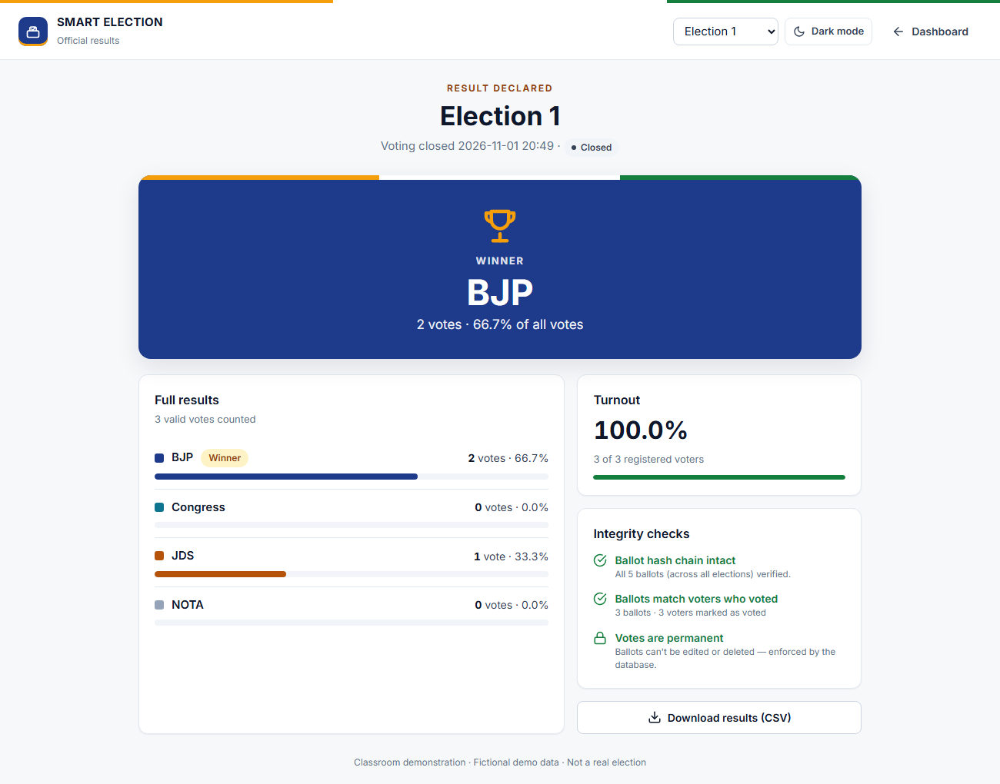

# Smart Election System (Classroom Demo)

A Python/Flask academic project that demonstrates face-verified electronic voting.
An election officer registers voters with the webcam, opens voting, voters verify
themselves by face (with a liveness check) and cast one secret ballot, and the
officer closes voting and declares the result.

**Officer-run system:** only the admin signs in. Every page sits behind the admin login; voters
register and vote on the officer's screen at the polling desk, like a real polling booth.

> **Demo only.** Uses fictional voter IDs. Not suitable for real elections — see
> the limitations in [docs/ARCHITECTURE.md](docs/ARCHITECTURE.md).



## Features

**Election**
- Election lifecycle: **Setup → Open → Closed**, one way only. Closed elections can't be reopened; start a new one instead (old ones stay in history).
- Candidate management (add / rename / remove) during setup; NOTA always included. The ballot locks when voting opens.
- Results are **sealed while voting is open** — not even the admin can see partial counts.
- Full-screen **results declaration** page with winner/tie, turnout and integrity checks, plus CSV export.

**Voting booth**
- Step-by-step: Scan face → Confirm → Vote → Done, then resets for the next voter.
- **Liveness check:** the voter closes and opens their eyes, so a printed photo can't vote.
- **English / हिंदी / ಕನ್ನಡ** and **voice prompts** (browser speech).

**Fairness & integrity** (enforced by SQLite triggers, not just the UI)
- Votes can **never be edited or deleted**. Each voter votes once per election.
- Secret ballot: ballots store no voter ID; the "who voted" table has no ordering that could link the two.
- Ballots and the audit log are **hash-chained**, so tampering with the database file is detected.
- **Audit log** of every admin action, sign-in, ballot (without voter ID) and rejected scan.
- Voters who have voted can't be removed.

**Voter registration** (on the officer's screen, inside the admin login)
- The officer (or the voter, at the officer's desk) enters name, date of birth, gender, **Voter ID (EPIC) or Aadhaar**, optional mobile, and upload a photo of their **ID card**, then do a face check with liveness.
- Automatic checks: ID format, **Aadhaar Verhoeff checksum**, ID not already used, **age 18+**, face clearly visible, only one person, liveness, photo quality, **same face not already registered**, photo present on the ID card.
- Hard failures are refused immediately; warnings go to the Registrations queue, where the officer compares the live photo with the ID card and **approves or rejects** with a reason.
- Privacy: the full ID number is **never stored**, only a masked copy (`XXXX XXXX 1234`) and a keyed hash for duplicate detection. Rejected applicants' face and ID card images are deleted.

**Voters & reports**
- A quick face-only registration is also available (duplicate faces are blocked); **photo thumbnails**; **retake face**; remove voters who never voted.
- **Accuracy test** page: recognition rate, false reject rate, misidentification and stranger-acceptance rate — numbers for your report.
- Clean light design that works on phones, tablets and projectors.

## Setup
```bash
python -m venv .venv
.venv\Scripts\activate          # Windows  (source .venv/bin/activate on Linux/macOS)
pip install -r requirements.txt
```
OpenCV 5 removed the Haar face detector, so `requirements.txt` pins OpenCV 4.

Download the AI face models (about 37 MB, from the official OpenCV Zoo):
```bash
python download_models.py
```

### AI face recognition and automatic approval
The app uses two deep-learning models from OpenCV Zoo, run by OpenCV's built-in DNN engine:
**YuNet** (face + landmark detection) and **SFace** (128-number face fingerprints; same person
when cosine similarity is 0.363 or more).

| Situation | Decision |
|---|---|
| All checks pass (valid ID, 18+, live person, ID-card face = live face, new face) | **Approved automatically** |
| Face clearly matches an existing voter or applicant (similarity 0.55 or more) | **Refused automatically** |
| ID-card face clearly a different person (under 0.20) or no face on the card | **Refused automatically** |
| Borderline similarity, poor photo, other people in frame | Sent to the officer for review |

The officer can switch automatic approval off on the Registrations page and spot-check the
**Auto-approved** tab. At the booth, SFace makes the final decision on who the voter is.

## Running
```bash
python app.py
```
Open http://127.0.0.1:5000 and sign in (default `admin` / `demo123`).

Typical demo:
1. **Register voter** for each participant (most are approved instantly by the AI; the rest appear under **Registrations**).
2. **Election setup** → name the election, check candidates → **Open voting**.
3. **Voting booth** → each voter scans their face, confirms and votes.
4. **Election setup** → **Close voting** (type the election name to confirm).
5. **Results** → project the declaration page. Check **Audit log** and **Accuracy test** for your report.

### Going live: fixed public address (Tailscale Funnel)
The site is published from this PC at a fixed HTTPS address of the form
`https://<machine-name>.<your-tailnet>.ts.net` (run `tailscale funnel status` to see yours).

Double-click **`start_live.bat`**. It switches on Tailscale Funnel (forwarding the address to
port 5000) and starts the production server (Waitress, `serve.py`).

- Needs a free Tailscale account signed in on this PC with Funnel enabled. Rename the machine
  (e.g. `tailscale set --hostname=election`) to choose the first part of the address.
- On first run `serve.py` creates a private **`.env`** file with a strong admin password and secret key
  (the old `demo123` no longer works). Never share or commit `.env`.
- The site works only while this PC is on and the server window is open.
- Waitress trusts only the local tunnel for the visitor's address (`X-Forwarded-For`, last hop), so login
  lockouts and rate limits apply per visitor and can't be dodged by faking the header.
- To take the site off the internet: `tailscale funnel --https=443 off`.
- Without Tailscale, `tools\cloudflared.exe tunnel --url http://127.0.0.1:5000` gives a temporary
  `trycloudflare.com` link instead.

### Configuration (environment variables)
| Variable | Default | Meaning |
|---|---|---|
| `DEMO_ADMIN_USERNAME` | `admin` | Admin username |
| `DEMO_ADMIN_PASSWORD` | `demo123` | Admin password (a warning is printed if not set) |
| `DEMO_SECRET_KEY` | random per run | Flask session key; set it to keep logins across restarts |
| `FACE_MATCH_THRESHOLD` | `0.85` | Max face distance (0–1.41). Lower = stricter |
| `LIVENESS_CHECK` | `on` | Set to `off` if eye detection struggles (e.g. glasses) |
| `REGISTRATION_LIMIT_PER_HOUR` | `30` | Self-registration attempts allowed per device per hour |
| `AI_SAME_PERSON` / `AI_CLEARLY_SAME` / `AI_CLEARLY_DIFFERENT` | `0.363` / `0.55` / `0.20` | AI similarity thresholds |

PowerShell example: `$env:DEMO_ADMIN_PASSWORD = "my-secret"; python app.py`

## Desktop (OpenCV window) tools
```bash
python add_faces.py    # register a voter from the terminal
python give_vote.py    # vote in an OpenCV window (voting must be open)
```

## Project structure
```
app.py             Flask app: login, dashboard, election, results, voters, audit, accuracy
voting_routes.py   Voting booth pages and APIs (identify + liveness, confirm, cast)
registration.py    Self-registration checks: ID format, Verhoeff, age, duplicates, quality, ID card
registration_routes.py  Voter registration form and the admin review queue
auth.py            Admin login, lockout, JSON-only admin actions, secret key
face_model.py      Face/eye detection, KNN matching, liveness, photos, accuracy test
face_ai.py         AI face recognition (YuNet + SFace): fingerprints, duplicates, ID-card match
download_models.py Downloads the AI models into models/
database.py        SQLite schema + integrity triggers, elections, ballots, hash chains, audit
templates/         Jinja pages (layout + dashboard, election, vote, results, voters, register, audit, accuracy)
static/style.css   Civic-light and dark themes (colours are CSS variables at the top)
static/app.js      Browser helpers: camera, API calls, dialogs, theme, voice
add_faces.py       Desktop registration script
give_vote.py       Desktop voting booth
docs/              Architecture diagrams and screenshots for the report
data/
  faces_data.pkl   Face samples (flattened 50x50 BGR crops)
  names.pkl        Voter ID per face sample
  photos/          Voter thumbnails
  pending/         Face samples of applicants awaiting approval (not used for voting)
  id_cards/        Uploaded ID card photos
  .id_pepper       Secret key for hashing ID numbers (keep private)
  voting_demo.db   SQLite database
```

An older database is upgraded automatically on first start; a copy of the original is
kept as `data/voting_demo.pre-migration.db`.

## License
MIT. See [LICENSE.txt](LICENSE.txt).
