# Smart Election System: Architecture

A classroom demonstration of face-verified electronic voting, built with Flask, OpenCV and SQLite.

## 1. System overview

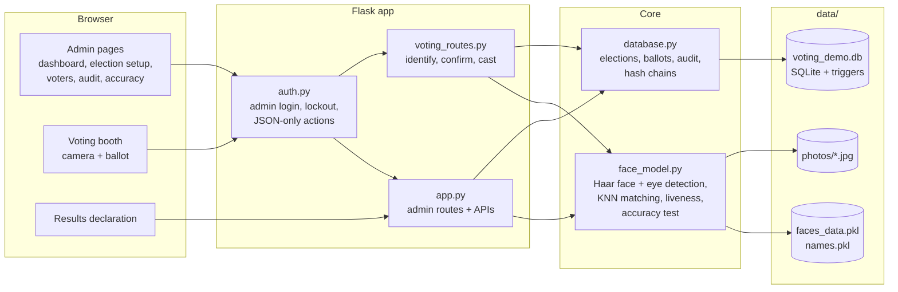

The desktop scripts `add_faces.py` (registration) and `give_vote.py` (OpenCV voting window) use the same `face_model.py` and `database.py`.

## 2. Voter self-registration

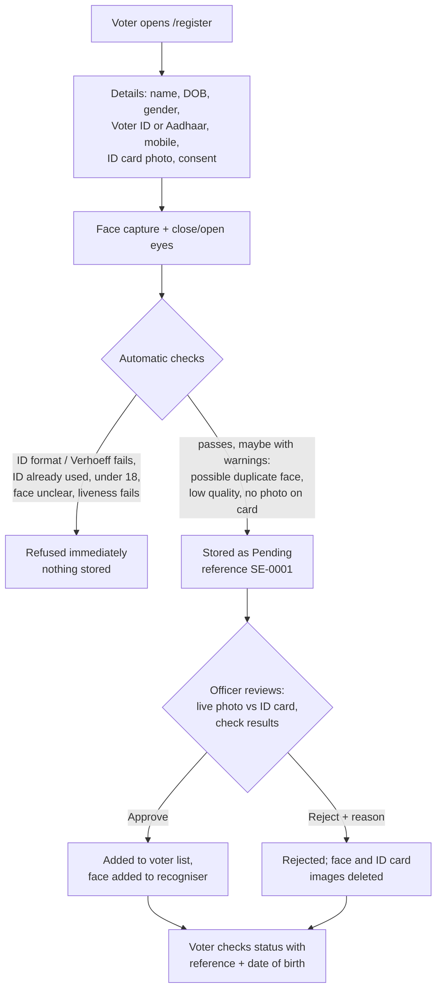

| Check | Type | Catches |
|---|---|---|
| EPIC format `AAA0000000` / Aadhaar 12 digits, not starting 0-1 | refuse | made-up or mistyped IDs |
| Aadhaar Verhoeff checksum | refuse | typos, random numbers |
| ID hash already pending/approved | refuse | the same ID used twice |
| Age 18+ | refuse | underage |
| ≥30 of 51 frames with exactly one clear face | refuse | bad capture |
| Liveness (eyes closed vs open) | refuse | printed photo |
| Face matches an existing voter or applicant | warn | one person, many IDs |
| Other faces in frame, low brightness or blur | warn | helpers in frame, poor photos |
| No face found on the ID card image | warn | wrong or unreadable document |

**ID privacy.** Full numbers are never stored: `id_masked` keeps the last 4 digits for display and
`id_hash = HMAC-SHA256(secret key, type:number)` detects duplicates. Without the key in
`data/.id_pepper`, the 12-digit Aadhaar space can't be brute-forced from the hash.

**Not possible in this demo:** confirming with UIDAI / Election Commission that an ID really exists
(needs official API access), and SMS OTP for the mobile number (needs a paid SMS gateway).

## 3. Election lifecycle

An election only moves forward. A closed election can never be reopened; a new election is created instead, and old ones stay in history.

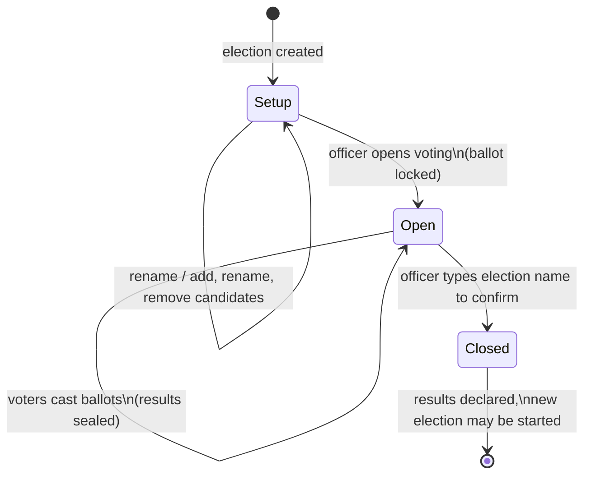

## 4. Voting flow (one voter)

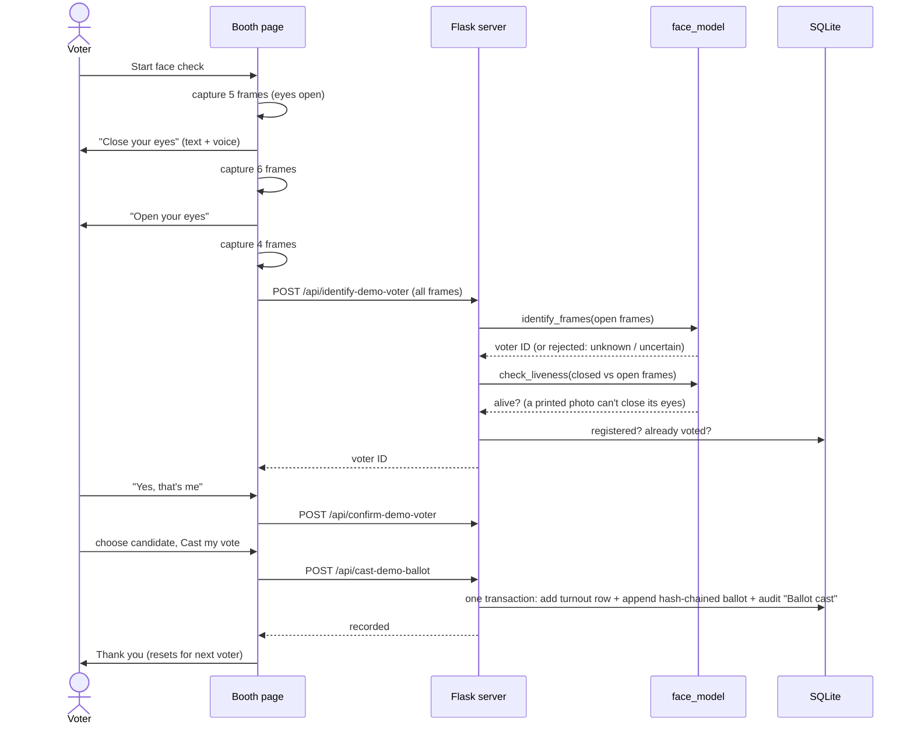

## 5. Data model

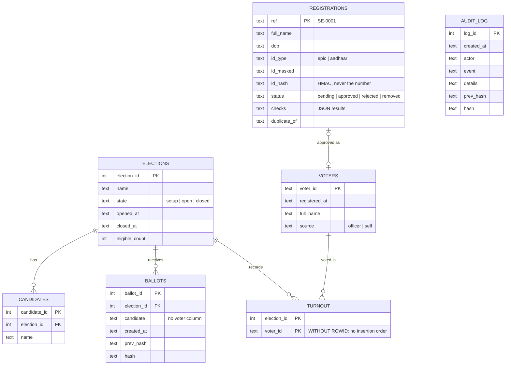

**Secret ballot.** `ballots` has no voter column. `turnout` records *who* voted but not *what*, and it is a `WITHOUT ROWID` table, so its storage order can't be matched against ballot order. The audit log records "Ballot cast" without a voter ID.

## 6. Integrity rules (enforced by SQLite triggers)

| Rule | How |
|---|---|
| Ballots can't be edited or deleted | `BEFORE UPDATE/DELETE` triggers raise an error |
| Ballots only while voting is open | `BEFORE INSERT` checks the election state |
| Only real candidates | `BEFORE INSERT` checks the candidates table |
| One vote per voter per election | `turnout` primary key + check in the same transaction |
| Turnout and audit log are permanent | update/delete triggers |
| Election only moves setup → open → closed | `BEFORE UPDATE` trigger on state |
| Ballot locked after opening | candidate triggers check `state = 'setup'` |
| Voters who voted can't be removed | `BEFORE DELETE` trigger + foreign key |
| Tampering is detectable | each ballot and audit entry stores `hash = SHA-256(previous hash, contents)`; the results and audit pages re-verify the chain |
| Registration decisions are final | trigger: pending → approved/rejected only; records never deleted |
| Results sealed until close | the results API and CSV export refuse while open |

## 7. Face recognition

1. **Detect.** OpenCV Haar cascade (`haarcascade_frontalface_default.xml`) finds exactly one face.
2. **Normalise.** Crop to 50×50, convert to grayscale, equalise the histogram, subtract the mean, scale to unit length (reduces lighting effects).
3. **Match.** k-nearest neighbours (k = 5). Accept only if at least 4 of 5 neighbours are the same voter **and** their mean distance is below `FACE_MATCH_THRESHOLD` (default 0.85). Otherwise the face is rejected as unknown.
4. **Agree.** The booth requires most frames to give the same voter, and no frame to give a different one.
5. **Liveness.** Eyes are detected with `haarcascade_eye.xml`. Eyes must be seen clearly more often in the open frames than in the "close your eyes" frames.

The **Accuracy test** page measures genuine accept rate, false reject rate, misidentification and false accept rate, using leave-out evaluation on the stored samples.

## 8. Known limitations (for the report)

- Pixel-based KNN is far weaker than modern face embeddings; accuracy drops with different lighting, angles or days.
- The liveness check stops printed photos but not a video replayed on a phone.
- Haar eye detection can struggle with glasses; set `LIVENESS_CHECK=off` if needed.
- Hash chains detect tampering but can't prevent someone with full file access from rebuilding the whole chain; a real system would publish the latest hash or sign it.
- Single admin account; no role separation between the election officer and the auditor.

## Screenshots

| | |
|---|---|
| 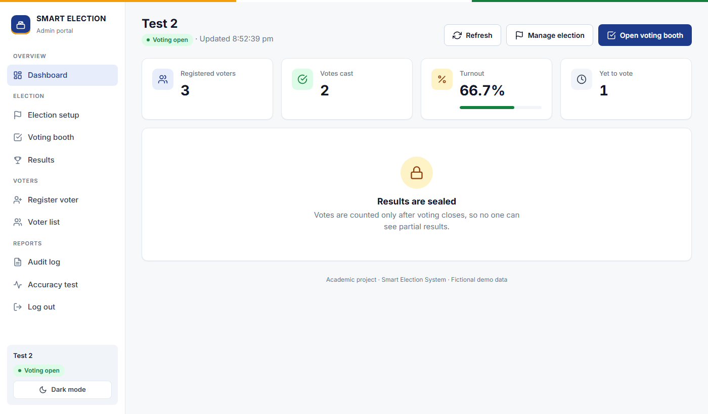 | 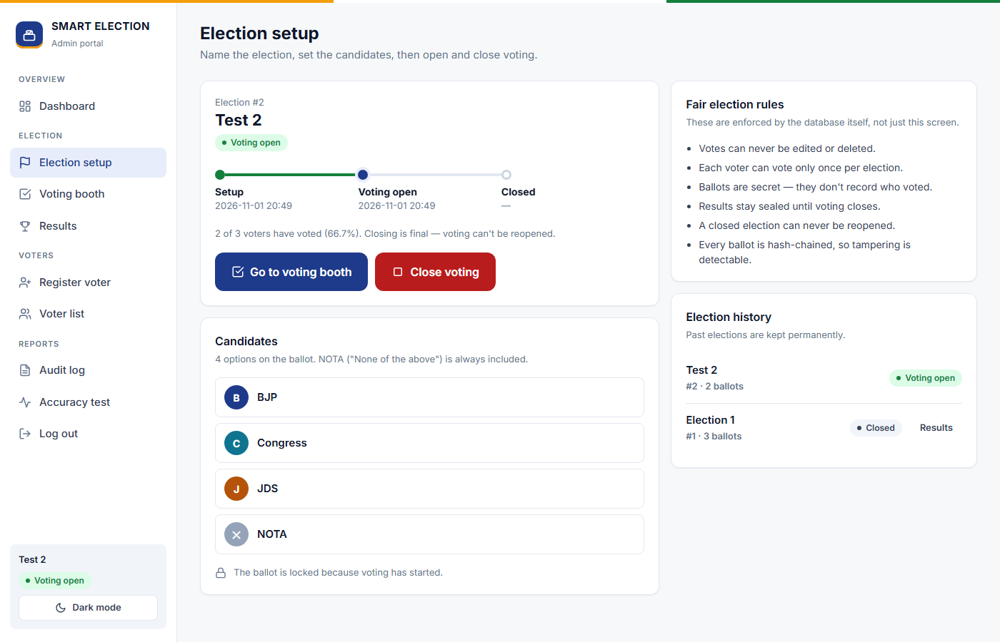 |
| 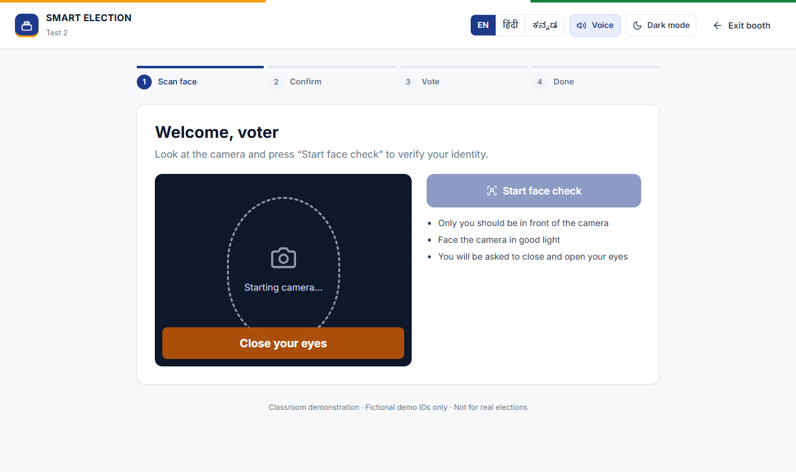 | 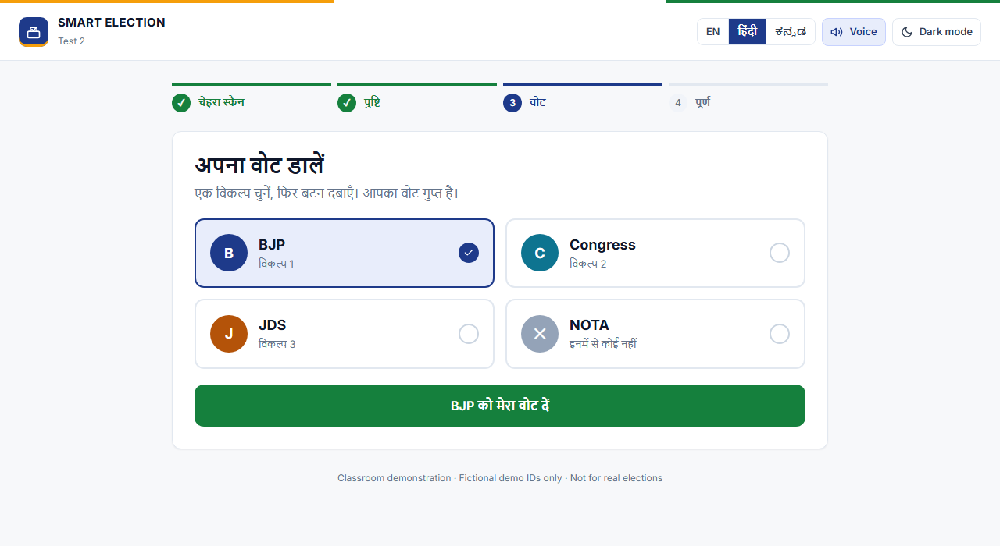 |
| 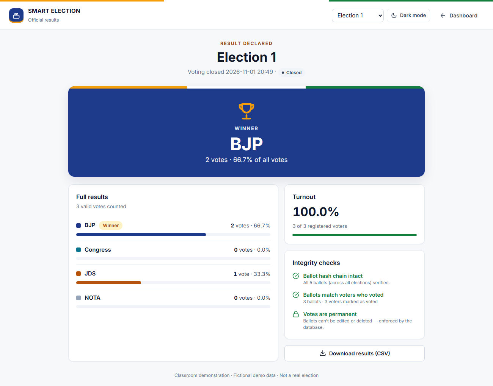 | 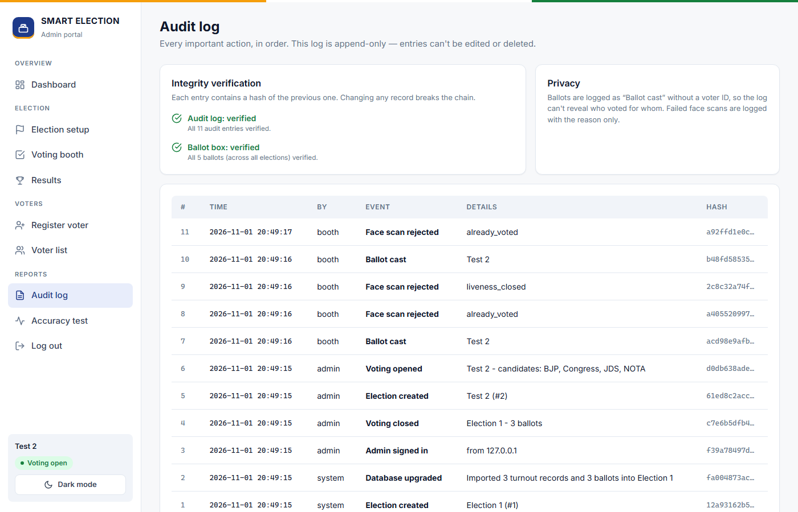 |
| 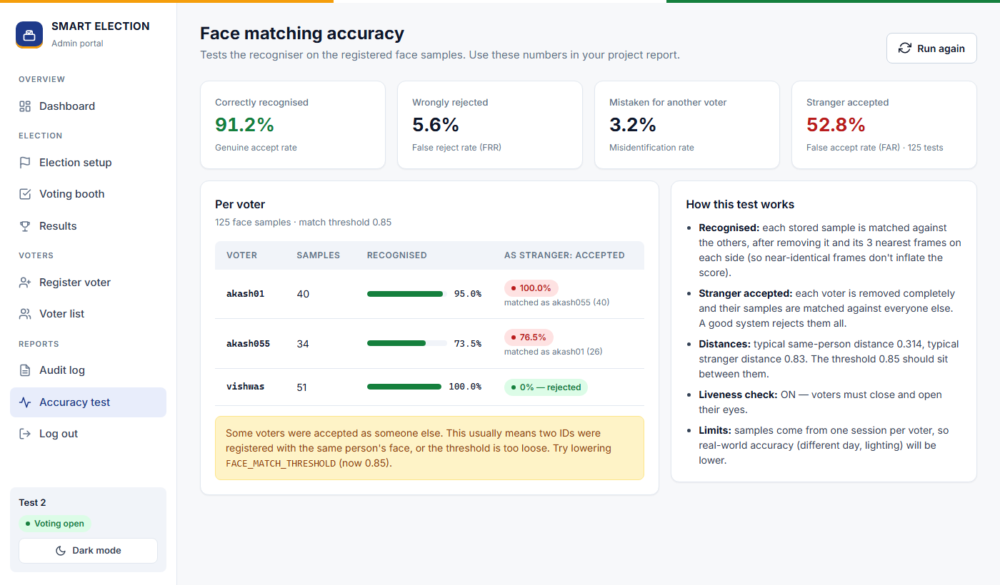 |  |
